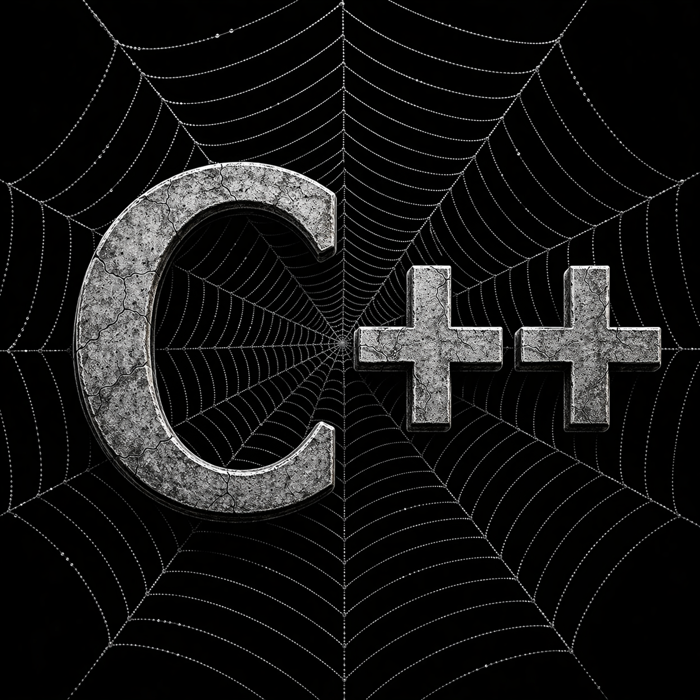

# MaiaCpp (WebCpp)
Maia C++ Compiler.

## Process Documentation

Mandatory cross-repository synchronization workflow:

- [docs/Maia_Ecosystem_Synchronization_Protocol.md](docs/Maia_Ecosystem_Synchronization_Protocol.md)



## Wrapper CLI

The published MaiaC static-member correction is consumed through this repository's
own submodule. `node compiler/tests/test-static-struct-members.js` checks direct
global/nested collector fields, unsigned updates, initialized static-local lifetime,
whole-object copies and callbacks against native C++98 with ASan/UBSan, strict
emitted C89 and actual WASM execution. The test runs in the default suite.


Unicode toolchain validation (2026-10-24): `npm test` and
`npm run check:maiaCC-selfhost-wasm` pass against the published MaiaCC Unicode
correction. The complete MaiaCC guest performs three stable C++98 -> C89 ->
WASM bootstrap generations and reproduces both emitters byte-for-byte on seven
grammars, including `unicode-scalars.ebnf`; invalid numeric ranges are rejected
inside WASM. The run exercises 27 actual memory growths. This is reference
WebAssembly execution, not MaiaWASMVM/device conformance.

The AST C89 path preserves adjacent C++98 string literals, global pointer
declarators, multiple pointer levels and forward/self-referencing struct types.
Global enum definitions and fixed scalar local array initializers retain their
values; variables declared in `for` initializers keep their loop scopes.
`npm run check:ast-c89-generator-contracts` requires executable parity between
native C++98 and emitted strict C89 for these generator contracts.
The AST C89 path also lowers do-while bodies and conditions through the existing
expression generator, preserving casts, nested loops, break/continue and condition
side effects. `node compiler/tests/test-do-while-casts.js` checks native C++98,
strict C89 and actual WASM results.
Allocation normalization also preserves quoted source templates and comments;
an embedded `new Set()` is data, while actual runtime allocations are lowered.

Use `bin/webcpp.sh` to generate AST and compilation artifacts:

```bash
./bin/webcpp.sh --file ./compiler/examples/test.cpp --all --out-dir ./out
```

Basic usage:

```bash
./bin/webcpp.sh <input.cpp> [options]
./bin/webcpp.sh --file <input.cpp> [options]
```

Supported outputs:

- AST in XML (`--ast-xml-out`)
- AST in JSON (`--ast-json-out`)
- AST in a tree in the terminal (`--ast-show`)

- Generated C (`--c-out`)

- Generated JS wrapper (`--js-out`, via MaiaC `webc`)

- WAT (`--wat-out`, via MaiaC)

- WASM (`--wasm-out`, via MaiaC)

Extended MaiaC `webc` options (forwarded by `webcpp.sh`):

- `--wat`
- `--no-validate`
- `--resolve-system-includes` / `--no-system-includes`
- `--dist`
- `--dist-run`
- `--name <appName>`
- `--webc-out-base <base>` (maps to `webc -o`)
- `--run`

Examples:

```bash
# C + WASM + WAT + JS in explicit paths
./bin/webcpp.sh ./compiler/examples/test.cpp \
	--c-out ./out/test.c \
	--wasm-out ./out/test.wasm \
	--wat-out ./out/test.wat \
	--js-out ./out/test.js

# Generate distribution package (browser + Node runner)
./bin/webcpp.sh ./compiler/examples/test.cpp \
	--dist --out-dir ./dist --name testapp

# Generate dist and run node runner immediately
./bin/webcpp.sh ./compiler/examples/test.cpp \
	--dist-run --out-dir ./dist --name testapp
```

Note:

- The default path is `C++ -> C (MaiaCpp) -> WAT/WASM (MaiaC)`.

- The `cpp-compiler.js` file only outputs C code.

- Define `MAIACPP_USE_C_ALLOCATOR` when compiling emitted C together with a real
	C allocator to disable the default `malloc/free` host-bridge macros. The
	generated-parser WASM regression uses the in-repository MaiaC C89 libc this way.
- `npm test` requires native C++98/emitted C89 equivalence for the lexer data
	contracts, then raw-text generated lexing, parsing, rollback and tree callbacks
	in actual WASM through the repository-local MaiaC and MaiaRegex submodules.
	It also runs the authoritative MaiaRegex C89 program tests in WASM. The full
	REx frontend and complete generator self-hosting remain separate gates.
	Unsigned compound assignments are also checked against native C++98 and actual
	WASM across scalars, arrays, pointers and struct fields. `%=` remains a typed
	C89 operator; the emitter does not force its operands to signed int. The pinned
	MaiaC supplies signedness-aware division/remainder/right-shift lowering.
- The preprocessor searches the repository-local C compatibility headers and
	MaiaCpp headers, without an implicit sibling MaiaC dependency. System-header
	macros are processed; standard declaration preludes remain the existing path.
	It defines `__cplusplus` as `199711L` for C++98 header linkage guards.
- AST lowering retains pointer-to-const parameters and return types, C linkage
	prototypes and postfix members after calls. Known type names resolve ambiguous
	`Type* name = value` statements into declarations at the start of their C89
	block, while initialization keeps its original execution order.
- `npm run check:maiaCC-rex-wasm` is the separate full REx
	frontend gate: strict C89 syntax validation, then guest lexing, parsing and XML
	serialization compared with the JavaScript oracle. It does not port the emitter.
- `npm run check:maiaCC-selfhost-wasm` builds the complete parallel C++98 MaiaCC
	frontend and both-language emitter through the local C89/WASM toolchain. It
	requires three stable guest bootstrap generations, final EBNF/XML and emitted
	source parity on REx/XML/WAT/shell/sample grammars, invalid-input rejection,
	stack restoration and real memory growth. JavaScript seeds generation zero
	and provides comparison oracles; guest code performs parsing and generation.
	Set `MAIACPP_SELFHOST_KEEP_TEMP=1` to retain emitted C and WASM for inspection.
	The native syntax check permits template string lengths beyond C89's required
	minimum using `-Wno-overlength-strings`, without permitting C99 syntax.
	Allow tens of minutes for the complete gate: large XML inputs repeatedly
	initialize the Regex runtime's dense memo tables. Device memory/time budgets
	and MaiaWASMVM execution require their own measurements; this gate runs in
	Node's WebAssembly engine.

- The only WAT file maintained in the project is `compiler/runtime.wat`, reserved for the runtime that covers what doesn't fit in the target C code, such as support for `try`/`catch`.

## Execution of test.cpp (console, Node, browser)

## Migration Guide (old → new)

Quick command mapping after the wrapper updates:

```bash
# Old
bash ./bin/run-test-node.sh ./compiler/examples/test.cpp
# New (equivalent legacy behavior)
bash ./bin/run-test-node.sh --file ./compiler/examples/test.cpp --mode legacy

# Old
bash ./bin/run-wasm-browser.sh ./compiler/examples/test.cpp
# New (equivalent legacy behavior)
bash ./bin/run-wasm-browser.sh --file ./compiler/examples/test.cpp --mode legacy

# New dist-oriented Node flow
bash ./bin/run-test-node.sh --file ./compiler/examples/test.cpp --mode dist --out-dir ./out/node-dist --name testapp

# New dist-oriented Browser flow
bash ./bin/run-wasm-browser.sh --file ./compiler/examples/test.cpp --mode dist --out-dir ./out/browser-dist --name testapp

# Passing extra MaiaC/webc flags through wrappers
bash ./bin/run-test-node.sh --file ./compiler/examples/test.cpp --mode dist -- --resolve-system-includes --wat
```

Unified stream (default: `compiler/examples/test.cpp`):

```bash
bash ./bin/run-test-cpp.sh --target all
```

Extended C++98 baseline (greater coverage in the current state):

```bash
bash ./bin/run-test-cpp.sh --file ./compiler/test_cpp98_extended.cpp --target all
```

Tiered C++98 suite + EBNF report (production):

```bash
node ./compiler/tests/run_tiered_cpp98.js
```

Semantic comparison of native C++ vs. generated C pipeline:

```bash
node ./compiler/tests/compare_cpp_vs_pipeline.js --file ./compiler/test_cpp98_extended.cpp
```

This command:

- compiles and executes native C++98
- generates C via MaiaCpp and executes the MaiaCpp -> MaiaC -> WASM pipeline in Node
- compares stdout and return code
- saves the generated C in `out/reports/cpp-vs-c/<file>.generated.c`

Dedicated MaiaCpp stress source (parse/transpile focus):

```bash
npm run check:stress:maiacpp
```

This validates `compiler/test_maiacpp_stress.cpp` through parser + C generation and writes:

- `out/reports/test_maiacpp_stress.ast.json`
- `out/reports/test_maiacpp_stress.generated.c`

Machine-readable output:

- `out/reports/ebnf-tiered-report.json`

Current Tiers:

- Tier 1: Node/WASM runtime (end-to-end scenario)
- Tier 2: compilation regression (fixtures)
- Tier 3: parse-only tracking for families still in gaps (e.g., linkage/asm/try-catch)

The report also informs how many families in the EBNF matrix are already tracked by cases Tiered (`matrixTracking`).

In its current state, this tracking already covers most of the matrix and should be updated with each execution of the tiered runner.

Individual Targets:

```bash
# Native Console (clang++/g++)
bash ./bin/run-test-console.sh ./compiler/examples/test.cpp

# Node + WASM (legacy mode)
bash ./bin/run-test-node.sh --file ./compiler/examples/test.cpp --mode legacy

# Node dist pipeline (webc --dist-run)
bash ./bin/run-test-node.sh --file ./compiler/examples/test.cpp --mode dist --out-dir ./out/node-dist --name testapp

# Browser + WASM (legacy mode; starts local server)
bash ./bin/run-wasm-browser.sh --file ./compiler/examples/test.cpp --mode legacy

# Browser dist runner (starts local server in dist folder)
bash ./bin/run-wasm-browser.sh --file ./compiler/examples/test.cpp --mode dist --out-dir ./out/browser-dist --name testapp

# Dist package validation (extended baseline)
npm run check:dist:node
npm run check:dist:browser-host

# Full heavy validation (manual, on-demand; not commit-hooked)
npm run ready:full
```

Runner in browser:

- `tools/browser/run-wasm.html`

- Accepts query `?wasm=/path/to/file.wasm`

## Minimal example with class (new)

File: `compiler/examples/example_class_plus_one.cpp`

```bash
# Node + WASM
bash ./bin/run-test-node.sh ./compiler/examples/example_class_plus_one.cpp

# Browser + WASM (port 8080)
bash ./bin/run-wasm-browser.sh ./compiler/examples/example_class_plus_one.cpp ./out/browser 8080

# Dedicated shortcuts for the simple example
bash ./bin/run-test-node-simple.sh
bash ./bin/run-wasm-browser-simple.sh ./out/browser 8080
```

The `test.cpp` file remains the complete baseline and has not been modified.

## Architecture

- See `docs/ARCHITECTURE.md` for an English architecture overview.

- See `docs/EBNF_IMPLEMENTATION_AUDIT.md` for a detailed gap definition against `grammar/Cpp.ebnf`.
- See `docs/CONFORMANCE_MATRIX.md` for implementation status by grammar family.
- See `docs/PRACTICAL_READINESS_TODO.md` for execution-focused tasks to make MaiaCpp production-ready.
